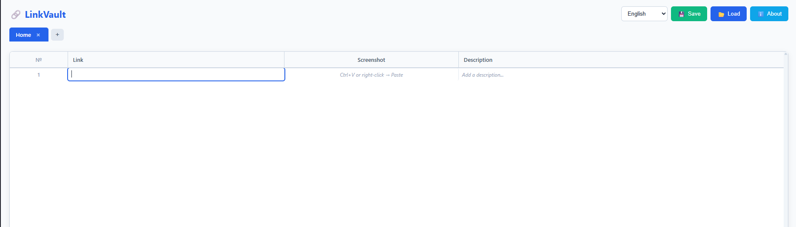

# LinkVault

LinkVault is a simple browser app for saving links, notes, and screenshots in one local table. It runs directly in your browser and does not require installation, a server, an account, or an `.exe` file.

## Download

[Download LinkVault.zip](https://github.com/milleran41/MyLinks/raw/main/LinkVault.zip)

## How to Run

1. Download `LinkVault.zip`.
2. Unpack the archive to any folder.
3. Double-click `LinkVault.html`.
4. LinkVault will open in your default browser.

There is no `.exe` file. LinkVault is a standalone HTML app, so the file you launch is `LinkVault.html`.

## Features

- Save links, descriptions, and screenshots in a clean table.
- Organize records into pages/categories.
- Rename and delete pages.
- Automatically highlight duplicate links.
- Store data locally in your browser with IndexedDB.
- Save and restore JSON backup files.
- Use a multilingual interface.

## Pages and Categories

On first launch, LinkVault creates one default page. In English it is named `Home`; in Russian it is `Главная`; in other interface languages it is translated as well.

- To create a new page, click the `+` button next to the page tabs.
- To rename a page, click the page name, type a new name, then press `Enter` or click somewhere else.
- To switch pages, click the page tab you want.
- To delete a page, click the `×` button on the tab.

If you manually rename the default page, it becomes a custom page name and is no longer translated automatically.

## Adding Records

Each row has four columns:

- `№` - row number.
- `Link` - the website address.
- `Screenshot` - an optional image preview.
- `Description` - your note about the link.

To add a record:

1. Click an empty cell in the `Link` column.
2. Paste or type a link.
3. Add a note in the `Description` column if needed.
4. When the last row has a link or description, LinkVault automatically adds a new empty row.

If you paste a link without `https://`, LinkVault adds it automatically.

## Adding Screenshots

1. Take a screenshot on your computer.
   - On Windows, you can use `Win + Shift + S`.
2. Return to LinkVault.
3. Click the `Screenshot` cell in the needed row.
4. Press `Ctrl+V`, or right-click and choose paste.
5. The screenshot is saved in that row.

Double-click a screenshot to open it larger. Use the `✕` button on the image to remove it from the row.

## Editing, Moving, and Deleting

- To edit a link or description, click the cell and change the text.
- To move a row, drag it to another position.
- To delete a row, right-click the row number and choose `Delete row`.
- If the same link is added more than once, duplicate rows are highlighted automatically.

## Backups

Your data is stored inside your browser. If browser data is cleared, LinkVault data can be lost.

Use the `Save` button regularly to create a backup file named `LinkVault_backup.json`. Use the `Load` button to restore data from a backup.

## Files

- `LinkVault.html` - the app itself.
- `readme.txt` - local help file opened by the `About` button.
- `assets/screenshot.png` - screenshot shown in this GitHub README.
- `LinkVault.zip` - ready-to-use download archive.

Personal backup files such as `LinkVault_backup.json` are intentionally not published and are not included in the archive.
